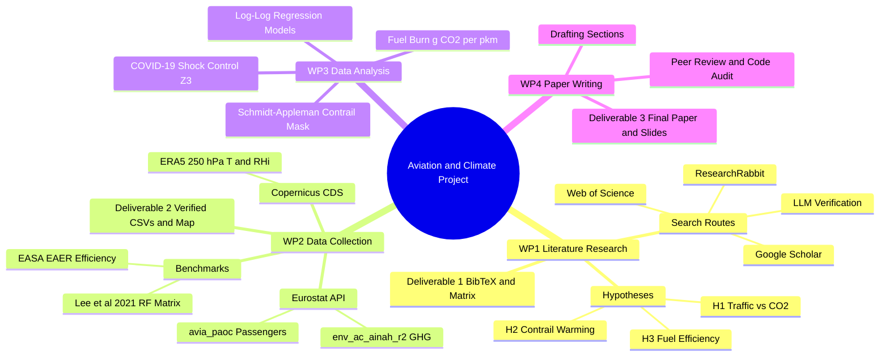
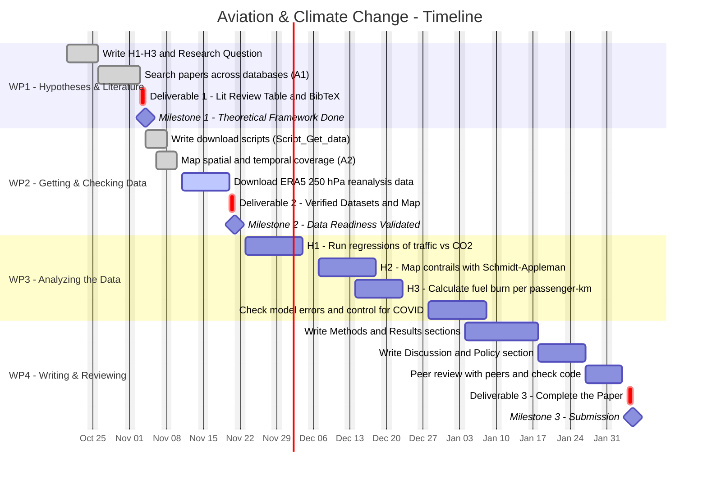
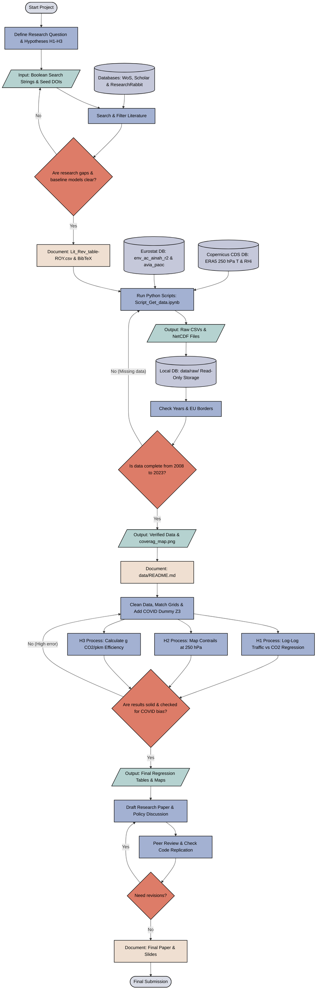

# Aviation and Climate Change: Greenhouse Gas Emissions, Contrails, and Aircraft Fuel

## Table of Contents
1. [Project Overview](#1-project-overview)
2. [Research Question & Hypotheses](#2-research-question--hypotheses)
3. [Variable Operationalization](#3-variable-operationalization)
4. [Work Packages & Project Mindmap](#4-work-packages--project-mindmap)
5. [Timeline, Milestones & Kanban Board](#5-timeline-milestones--kanban-board)
6. [Research Workflow Diagram](#6-research-workflow-diagram)
7. [Risk Mitigation Table](#7-risk-mitigation-table)
8. [Repository Structure](#8-repository-structure)
9. [Data Sources, Versions, Licences & Citations](#9-data-sources-versions-licences--citations)
10. [References](#10-references)

---

## 1. Project Overview

Commercial aviation drives global mobility and trade, but it exerts complex radiative forcing pressures on the global climate system. Beyond direct carbon dioxide ($\text{CO}_2$) emitted from jet fuel combustion, aircraft operations in the cold, ice-supersaturated upper troposphere trigger persistent condensation trails (contrails) and contrail-induced cirrus clouds. These artificial clouds trap outgoing longwave radiation while partially reflecting incoming solar radiation, yielding a net positive warming effect.

Although modern airframe and engine designs continuously improve fuel efficiency per passenger-kilometre, global traffic demand growth risks offsetting these technological gains. This research project investigates the empirical relationship between air traffic volume, direct combustion emissions, atmospheric conditions governing contrail persistence, and fleet fuel efficiency across European airspace.

---

## 2. Research Question & Hypotheses

### Primary Research Question
> *How does commercial aviation activity contribute to climate change through direct $\text{CO}_2$ emissions and persistent contrails, and to what extent can improvements in aircraft fuel efficiency reduce emissions per passenger-kilometre despite increasing traffic demand?*

### Refined Hypotheses
* **H1 (Traffic Activity vs. $\text{CO}_2$ Emissions):** Aviation-related $\text{CO}_2$ emissions increase monotonically with commercial air traffic activity.
* **H2 (Contrail Formation & Radiative Forcing):** Persistent aircraft contrails contribute to atmospheric warming by trapping outgoing longwave radiation while partially reflecting incoming solar radiation, resulting in net positive radiative forcing.
* **H3 (Fuel Efficiency vs. Demand Growth):** Technological and operational improvements reduce $\text{CO}_2$ emissions per passenger-kilometre ($g\,\text{CO}_2/\text{pkm}$), but absolute sector emissions continue to rise if passenger demand growth outpaces efficiency improvements.

---

## 3. Variable Operationalization

| Role | Code | Variable Name | Operational Definition | Metric / Unit | Expected Direction | Hypothesis |
| :--- | :--- | :--- | :--- | :--- | :--- | :--- |
| **Response** | **Y1** | Aviation $\text{CO}_2$ Emissions | Annual mass of carbon dioxide emitted from jet fuel combustion | $\text{Mt}\,\text{CO}_2$ / year | Positive (+) | H1 |
| **Predictor** | **X1** | Air Traffic Activity | Commercial IFR flight movements & Revenue Passenger-Kilometres | Flights / year & RPK | Positive (+) | H1 |
| **Response** | **Y2** | Contrail Radiative Forcing | Net perturbation of Earth's radiation balance by contrail-cirrus (LW minus SW) | $\text{mW}/\text{m}^2$ | Positive (+) | H2 |
| **Predictor** | **X2** | Contrail Permissibility Index | Upper tropospheric conditions meeting Schmidt-Appleman criterion ($T \le -40^\circ\text{C}$ & $RHi \ge 100\%$ at 200–300 hPa) | % cruise time / grid frequency | Positive (+) | H2 |
| **Response** | **Y3** | Specific Emission Intensity | Average greenhouse gas emissions generated per unit of passenger transport work | $g\,\text{CO}_2/\text{pkm}$ | Negative (–) | H3 |
| **Predictor** | **X3** | Fleet Fuel Efficiency | Fleet-averaged Specific Fuel Consumption (SFC) and passenger load factors | kg fuel / seat-km & % load | Negative (–) | H3 |
| **Control** | **Z1** | Route Network Distribution | Proportion of short-haul (<500 km), medium-haul (500–1500 km), and long-haul (>1500 km) flights | % of total departures | Confounder | H1, H3 |
| **Control** | **Z2** | Background Cloudiness | Pre-existing natural cirrus optical depth and Top-of-Atmosphere (TOA) background albedo | Dimensionless optical depth ($\tau$) | Confounder | H2 |
| **Control** | **Z3** | Exogenous Macro Shocks | COVID-19 pandemic restrictions (2020) and global jet fuel price shocks | Binary dummy / Brent USD per barrel | Confounder | H1, H3 |

---

## 4. Work Packages & Project Mindmap

### Work Packages (WPs)
This project is structured into four main work packages:

* **WP1: Literature Research & Hypotheses**
  * Set up the research question, define variables, and formulate the three hypotheses (H1–H3).
  * Search literature across Web of Science, Google Scholar, and ResearchRabbit, and verify papers using an LLM.
  * Set up the Git repository, create a `data/raw/` directory, and write `data/README.md` following FAIR guidelines.
* **WP2: Data Collection & Preprocessing**
  * Write Python scripts to download emissions (`env_ac_ainah_r2`) and passenger data (`avia_paoc`) from Eurostat.
  * Set up weather data downloads (ECMWF ERA5 250 hPa temperature and humidity) using the Copernicus `cdsapi`.
  * Verify file checksums (SHA-256) and check spatial/temporal coverage across Europe from 2008 to 2023.
* **WP3: Data Analysis & Testing Hypotheses**
  * **Testing H1:** Run log-log regressions to quantify how strongly passenger numbers drive total $\text{CO}_2$ emissions.
  * **Testing H2:** Map flight paths over ERA5 weather maps to identify contrail formation regions using the Schmidt-Appleman criterion ($T \le -40^\circ\text{C}$ and $RHi \ge 100\%$).
  * **Testing H3:** Calculate emissions per passenger-kilometre to assess whether engine/fleet improvements offset traffic growth.
  * Perform robustness checks to ensure the 2020 COVID-19 flight drop (`Z3`) does not distort regression elasticity estimates.
* **WP4: Paper Writing & Review**
  * Draft the methodology, empirical results, and policy discussion (e.g., CORSIA, EU ETS, and SAF targets).
  * Conduct peer review with classmates, audit code reproducibility on an independent machine, and fix issues.
  * Prepare final presentation slides and submit the final paper and repository.

### Project Mindmap



---

## 5. Timeline, Milestones & Kanban Board

### Gantt Chart



### Milestones & Deliverables
* **Milestone 1 (M1) [2026-11-04]:** Finished the research scope, questions, and hypotheses.
  * **Deliverable 1 (D1):** Literature research summary table and BibTeX file.
* **Milestone 2 (M2) [2026-11-21]:** All datasets downloaded and verified on the working machine.
  * **Deliverable 2 (D2):** Data collection scripts and 3-panel coverage verification map.
* **Milestone 3 (M3) [2027-02-05]:** Project completed, presented, and submitted.
  * **Deliverable 3 (D3):** Final research report, figures, and clean GitHub repository.

### Kanban Board

This Kanban board tracks daily task progress and limits work-in-progress across the project lifecycle.

| Backlog | To Do | In Progress | In Review / Checking | Done |
| :--- | :--- | :--- | :--- | :--- |
| **[WP3]** Test COVID dummy `Z3` on regressions | **[WP2]** Finish `cdsapi` download for ERA5 250 hPa levels | **[WP2]** Convert ERA5 NetCDF files to extract $T$ and $RHi$ | **[WP2]** Check downloaded CSVs | **[WP1]** Write down research question and H1, H2, H3 |
| **[WP4]** Draft Discussion on SAF targets and rebound effect | **[WP3]** Set up log-log regression for passengers vs. emissions | **[WP2]** Compare Eurostat emissions with EDGAR v8.0 data | **[WP2]** Check 3-panel coverage map | **[WP1]** Search literature on WoS, Google Scholar, and ResearchRabbit |
| **[WP4]** Format all citations into APA 7th style | **[WP3]** Build the Schmidt-Appleman mask ($T \le -40^\circ\text{C}$, $RHi \ge 100\%$) | | | **[WP1]** Set up GitHub repository and write `data/README.md` |
| **[WP4]** Make slides for final project presentation | **[WP3]** Calculate fuel burn per passenger-km `Y3` ($g\,\text{CO}_2/\text{pkm}$) | | | **[WP2]** Download Eurostat emissions and traffic files |

---

## 6. Research Workflow Diagram

This flowchart maps out the end-to-end research pipeline using standard flowchart symbols (Start/End, Process, Decision, Input/Output, Document, and Database).



---

## 7. Risk Mitigation Table

| Risk ID | What could go wrong? | Likelihood | Impact | How will I notice it early? | What is my plan to fix it? |
| :---: | :--- | :---: | :---: | :--- | :--- |
| **R1** | **Copernicus ERA5 download is too slow:** Requests stay stuck in the queue or time out due to large file sizes. | High | High | The script stays queued for more than 48 hours or throws connection errors. | Download only the two cruising pressure levels needed (250 hPa and 300 hPa) at monthly resolution, restricted to the European bounding box ($34^\circ\text{N}\text{–}70^\circ\text{N}$, $15^\circ\text{W}\text{–}35^\circ\text{E}$). |
| **R2** | **COVID-19 flight drop skews regression:** The ~60% traffic drop in 2020 distorts elasticity estimates. | High | High | Regression residuals fail normality tests or show large spikes around 2020–2021. | Add a COVID dummy variable ($Z3 = 1$ for 2020–2021) and estimate models separately for pre-COVID years (2008–2019) and the full sample. |
| **R3** | **Cannot measure contrail warming directly:** Eurostat emissions data does not track contrail clouds or radiative forcing. | High | Medium | Territorial emissions totals cannot show whether contrails actually formed. | Use ERA5 temperature and ice-supersaturation as physical proxies alongside published radiative forcing benchmarks from Lee et al. (2021). |
| **R4** | **Eurostat changes its API or table format:** An update to Eurostat's SDMX API breaks the download script. | Medium | High | The Python script throws a `404` or `400` error, or Pandas produces column format warnings. | Archive all downloaded CSVs in `data/raw/` as read-only files with SHA-256 checksums so re-downloading is unnecessary if the API changes. |
| **R5** | **Cartopy crashes when plotting maps:** Missing map libraries or memory errors crash plotting scripts. | Medium | Low | Python raises a Cartopy `ImportError` or runs out of memory rendering borders. | Maintain a fallback in `Script_Spatial_mapping.ipynb` using standard Matplotlib and a local GeoJSON file so maps render without Cartopy. |

---

## 8. Repository Structure

```text
.
├── data/
│   └── raw/                    # Raw, unedited data downloaded by automated scripts
│       ├── eurostat_aviation_ghg_emissions.csv
│       └── eurostat_aviation_traffic_pax.csv
│
├── scripts/
│   ├── 01_get_data.py          # Script downloading primary candidate datasets into data/raw/
│   └── plot_quick_map.py       # Script generating coverage verification plots
│
├── reports/
│   └── figures/                # Output visualizations and verification plots
│       └── coverage_verification_map.png
│
└── README.md                   # Root repository overview (this file)
```

---

## 9. Data Sources, Versions, Licences & Citations

1. **Eurostat (2024a)**
   * **Citation:** European Commission, Eurostat. (2024). *Air emissions accounts by NACE Rev. 2 activity (Air transport: H51)* [Data file: `env_ac_ainah_r2`]. European Commission. https://ec.europa.eu/eurostat/web/products-datasets/-/env_ac_ainah_r2
   * **Source:** Statistical Office of the European Union (Eurostat)
   * **Version:** 2024 Production Release
   * **Licence:** Creative Commons Attribution 4.0 International (CC-BY 4.0) / EU Open Data Policy (Decision 2011/833/EU)
   * **Date Accessed:** 08 November 2026

2. **Eurostat (2024b)**
   * **Citation:** European Commission, Eurostat. (2024). *Air passenger transport by reporting country* [Data file: `avia_paoc`]. European Commission. https://ec.europa.eu/eurostat/web/products-datasets/-/avia_paoc
   * **Source:** Statistical Office of the European Union (Eurostat)
   * **Version:** 2024 Release
   * **Licence:** Creative Commons Attribution 4.0 International (CC-BY 4.0) / EU Open Data Policy (Decision 2011/833/EU)
   * **Date Accessed:** 08 November 2026

3. **ECMWF / Copernicus (2020)**
   * **Citation:** Hersbach, H., Bell, B., Berrisford, P., et al. (2020). *The ERA5 global reanalysis*. Quarterly Journal of the Royal Meteorological Society, 146(730), 1999–2049. https://doi.org/10.1002/qj.3803 (CDS Dataset DOI: https://doi.org/10.24381/cds.bd0915c6)
   * **Source:** Copernicus Climate Change Service (C3S) / ECMWF
   * **Version:** ERA5.1 (250 hPa / 300 hPa Pressure Levels)
   * **Licence:** Copernicus Open Access Licence
   * **Date Accessed:** 08 November 2026

4. **Lee et al. (2021)**
   * **Citation:** Lee, D. S., Fahey, D. W., Skowron, A., et al. (2021). *The contribution of global aviation to anthropogenic climate forcing for 2000 to 2018*. Atmospheric Environment, 244, Article 117834. https://doi.org/10.1016/j.atmosenv.2020.117834
   * **Source:** Institute of Atmospheric Physics (DLR) / Manchester Metropolitan University (Zenodo Archive)
   * **Version:** 2000–2018 Matrix
   * **Licence:** Creative Commons Attribution 4.0 International (CC-BY 4.0)
   * **Date Accessed:** 08 November 2026

5. **Supplementary Benchmark & Validation Datasets (Planned in WP2)**
   * **EASA / EEA:** *European Aviation Environmental Report (EAER)* — EEA / EASA Open Access Licence
   * **European Commission JRC:** *EDGAR v8.0 Global Greenhouse Gas Emissions* — Creative Commons Attribution 4.0 International (CC-BY 4.0)
   * **EUROCONTROL & OpenSky Network:** *Aviation Intelligence Portal & Trajectory Data* — Open for Research / Academic Non-Commercial Licence

---

## 10. References

1. **Eurostat. (2024a).** *Air emissions accounts by NACE Rev. 2 activity (Air transport: H51)* [Data file: `env_ac_ainah_r2`]. European Commission. https://ec.europa.eu/eurostat/web/products-datasets/-/env_ac_ainah_r2
2. **Eurostat. (2024b).** *Air passenger transport by reporting country* [Data file: `avia_paoc`]. European Commission. https://ec.europa.eu/eurostat/web/products-datasets/-/avia_paoc
3. **Hersbach, H., Bell, B., Berrisford, P., et al. (2020).** *The ERA5 global reanalysis*. Quarterly Journal of the Royal Meteorological Society, 146(730), 1999–2049. https://doi.org/10.1002/qj.3803
4. **Hersbach, H., Bell, B., Berrisford, P., et al. (2023).** *ERA5 hourly data on pressure levels from 1940 to present*. Copernicus Climate Change Service (C3S) Climate Data Store (CDS). https://doi.org/10.24381/cds.bd0915c6
5. **Lee, D. S., Fahey, D. W., Skowron, A., et al. (2021).** *The contribution of global aviation to anthropogenic climate forcing for 2000 to 2018*. Atmospheric Environment, 244, Article 117834. https://doi.org/10.1016/j.atmosenv.2020.117834

---

## Author

* **Name:** Sanglap Roy  
* **Matriculation No.:** 6385648  
* **Last Updated:** November 2026  

### Data Sources
* Eurostat Air Transport GHG Accounts (`env_ac_ainah_r2`)
* Eurostat Commercial Air Passenger Transport (`avia_paoc`)
* ECMWF / Copernicus ERA5 Reanalysis 250 hPa (`10.24381/cds.bd0915c6`)
* Lee et al. (2021) Aviation Radiative Forcing Matrix (`10.1016/j.atmosenv.2020.117834`)
* EASA / EEA European Aviation Environmental Report (EAER)
* JRC EDGAR v8.0 & EUROCONTROL Aviation Intelligence Portal

### Licences
* Creative Commons Attribution 4.0 International (CC-BY 4.0)
* EU Open Data Policy (Decision 2011/833/EU)
* Copernicus Open Access Licence (ECMWF ERA5)
* EEA / EASA Open Access Licence
* Open for Research / Academic Non-Commercial (EUROCONTROL & OpenSky)

### Tags
* `research-skills/A3`
* `aviation/climate`
* `contrails/ERA5`
* `fuel-efficiency`
* `aviation/GHG`

---
