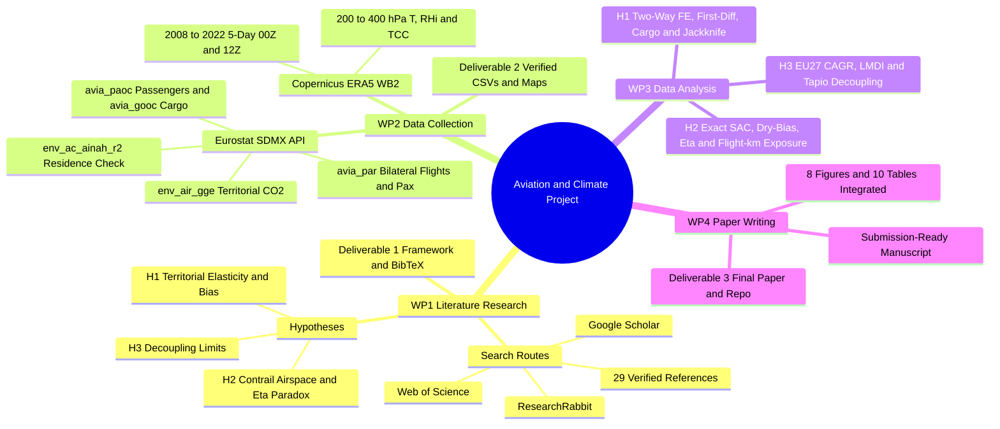
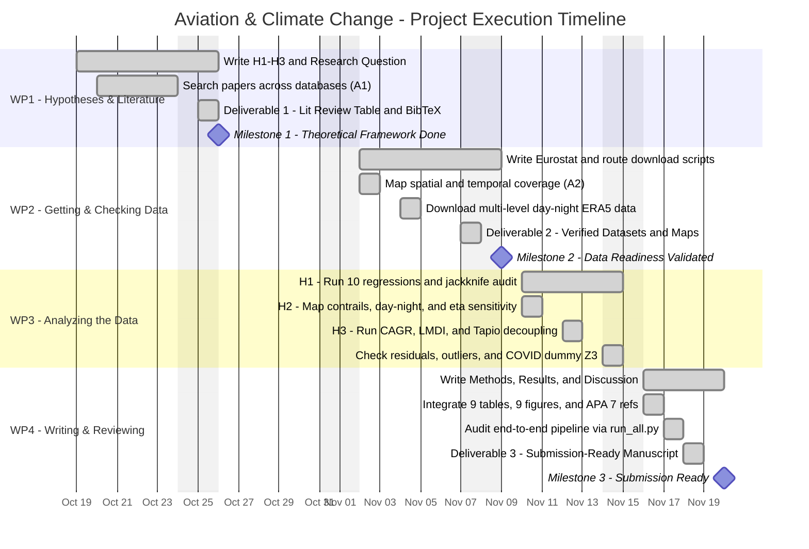
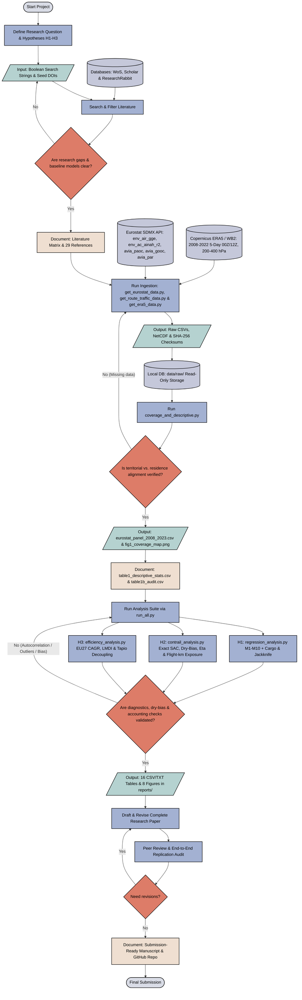

# Aviation and Climate Change: Traffic–Emissions Elasticities, Contrail-Permissive Airspace, and Decoupling Limits in European Aviation (2008–2023)

## Table of Contents
1. [Project Overview](#1-project-overview)
2. [Research Question & Hypotheses](#2-research-question--hypotheses)
3. [Variable Operationalization](#3-variable-operationalization)
4. [Work Packages & Project Mindmap](#4-work-packages--project-mindmap)
5. [Timeline, Milestones & Kanban Board](#5-timeline-milestones--kanban-board)
6. [Research Workflow Diagram](#6-research-workflow-diagram)
7. [Risk Mitigation Table](#7-risk-mitigation-table)
8. [Repository Structure](#8-repository-structure)
9. [Data Sources, Versions, Licences & Citations](#9-data-sources-versions-licences--citations)
10. [References](#10-references)

---

## 1. Project Overview

Commercial aviation connects European economies and supports global trade and mobility, yet it warms the climate through both direct carbon dioxide ($\text{CO}_2$) emissions from jet fuel combustion and non-($\text{CO}_2$) persistent condensation trails (contrails) formed in cold, ice-supersaturated upper-tropospheric air. While fleet renewal and operational improvements reduce emissions per passenger over time, sustained air traffic growth risks outpacing these intensity reductions.

This repository houses the complete, reproducible data ingestion pipeline, econometric models, multi-level atmospheric reanalysis scripts, output tables, and figures investigating European airspace (`34°N–70°N, 15°W–35°E`) across **2008–2023** (with complete-year ERA5 meteorological reanalysis spanning **2008–2022**).

### Summary of Empirical Findings
- **H1 (Territorial Traffic–$\text{CO}_2$ Elasticity & Accounting Bias):** Aligning emissions to territorial UNFCCC/EEA bunker inventories (`env_air_gge`: domestic `CRF1A3A` + international bunkers `CRF1D1A`) and controlling for air cargo (`avia_gooc`) across 31 European states ($N = 480$) shows that a 1% increase in passenger traffic raises territorial aviation $\text{CO}_2$ by **0.692%** in Two-Way Fixed Effects (`M5`, $R^2 = 0.9951$, $p < 0.0001$; **0.744%** after outlier trimming in `M9`, **0.799%** with country trends in `M7`, and bounded between **0.665** and **0.795** in a 31-country jackknife) and by **0.764%** in annual First Differences (`M6`, $R^2 = 0.9088$, $\text{DW} = 2.26$, $p < 0.0001$), alongside a significant air-cargo elasticity of **0.103%–0.210%** (combined short-run elasticity **0.97**). By contrast, residence-based airline accounts (`env_ac_ainah_r2`) distort hub emissions up to **5.25-fold** (Ireland) and inflate regression standard errors **2.45-fold** (`M10`).
- **H2 (Contrail-Permissive Airspace & Corridor Exposure):** Across 2008–2022 Copernicus ERA5 / WeatherBench2 grids (5-day regular sampling at `00:00` and `12:00 UTC`, 2,192 timestamps, `200–400 hPa`), exact Schmidt–Appleman ($T \le T_{\text{LM}}$) and ice-supersaturation ($\text{RH}_i \ge 100\%$) conditions peak at **250 hPa** (~34,000 ft / 10.4 km) at **8.12%** of observations (**49.11%** occurring at night without solar cooling), rising to **12.06%–13.91%** under mild-to-moderate ERA5 dry-bias adjustments ($\text{RH}_i \ge 97\%$–$95\%$). Stepping down to 300 hPa cuts summer contrails by **75.7%** (5.64% to 1.37%) but *worsens* winter contrails (9.90% vs. 9.19%). Raising overall propulsion efficiency ($\eta = 0.25 \to 0.40$) raises $T_{\text{LM}}$ by $+2.34^\circ\text{C}$ and expands contrail-permissive airspace from **7.90%** to **8.40%** at 250 hPa and **5.26%** to **6.65%** at 300 hPa. Weighting by 2019 cruise-adjusted commercial aircraft-kilometres (`avia_par_*` flights $\times$ cruise distance, matched to 300 hPa for $<600\text{ km}$ and 250 hPa for $\ge 600\text{ km}$) reveals that just three medium-haul corridors—**Frankfurt–Stockholm (18.19%)**, **London–Frankfurt (17.64%)**, and **Paris–Madrid (16.87%)**—generate **52.70%** of total exposure across ten core corridors.
- **H3 (Decoupling Limits of Intensity Gains):** Between 2008 and 2019, official `EU27_2020` per-passenger territorial $\text{CO}_2$ intensity fell by **18.93%** (**-1.89%/yr**, from `174.55` to `141.51 kg CO2/pax`, reaching `139.87 kg CO2/pax` in 2023), closely matching M6's autonomous efficiency drift (`-1.95%/yr`). However, commercial passenger volume surged by **46.66%** (**+3.54%/yr**), driving net territorial $\text{CO}_2$ up by **18.90%** (**+1.59%/yr**) pre-COVID and leaving 2023 emissions **9.47%** above 2008 levels. EU27 LMDI and Tapio decompositions confirm that strong decoupling occurred only in 2012–2013, while 2016–2017 experienced expansive coupling ($e = 0.912$–$0.960$) and 2021–2023 remained confined to weak decoupling ($e = 0.463$–$0.700$).

### Quickstart: Reproducing the Full Pipeline
```bash
# 1. Clone repository (with Git LFS for large Eurostat CSV archives)
git lfs install
git clone https://github.com/SanRoy-9/Aviation_and_Climate_Change.git
cd Aviation_and_Climate_Change

# 2. Install Python dependencies
pip install numpy pandas scipy statsmodels xarray netCDF4 zarr requests matplotlib cartopy

# 3. Run the complete 7-stage ingestion, modeling, and visualization pipeline
python scripts/run_all.py
```

---

## 2. Research Question & Hypotheses

### Primary Research Question
> *How elastically do European territorial aviation $\text{CO}_2$ emissions respond to passenger and cargo demand, how are persistent contrail-permissive conditions distributed across European cruise altitudes and flight corridors, and to what extent have per-passenger intensity reductions decoupled EU27 aviation emissions from traffic growth?*

### Tested Hypotheses
- **H1 (Territorial Traffic–Emissions Elasticity & Accounting Bias):** Controlling for air cargo volume and secular time trends, territorial aviation $\text{CO}_2$ emissions across European states exhibit a high, near-unitary short-run elasticity with respect to passenger volume across pre-pandemic, COVID-19, and recovery regimes, whereas residence-based airline accounts introduce severe cross-country distortion and estimation noise.
- **H2 (Spatiotemporal Contrail-Permissive Exposure & Propulsion Paradox):** Persistent contrail-permissive conditions ($T \le T_{\text{LM}}$, $\text{RH}_i \ge 100\%$) in European cruise airspace are concentrated along northern and central flight corridors, occur nearly equally at night (when solar shortwave cooling is absent), expand thermodynamically as aircraft engine propulsion efficiency ($\eta$) increases, and concentrate disproportionately on a small subset of medium-haul corridors when weighted by cruise-adjusted aircraft-kilometres.
- **H3 (Decoupling Limits of Per-Passenger Intensity Gains):** Although operational and fleet improvements substantially lowered EU27 territorial $\text{CO}_2$ emissions per passenger between 2008 and 2023, sustained passenger demand growth outpaced intensity reductions, confining European aviation to weak decoupling rather than absolute emissions decline.

---

## 3. Variable Operationalization

| Role | Code | Variable Name | Operational Definition | Metric / Unit | Expected Direction | Hypothesis |
| :--- | :--- | :--- | :--- | :--- | :--- | :--- |
| **Primary Response** | **Y1** | Territorial Aviation $\text{CO}_2$ | Annual territorial $\text{CO}_2$ from UNFCCC/EEA `env_air_gge` summing domestic aviation (`CRF1A3A`) + international bunkers (`CRF1D1A`) | Thousand tonnes $\text{CO}_2$ (`ln_co2`) | Positive (+) | H1, H3 |
| **Benchmark Response** | **Y1b** | Residence-Principle Aviation GHG | Annual NACE Rev. 2 `H51` air transport GHG (`env_ac_ainah_r2`) used strictly for accounting boundary audit (`Table 1b` & `M10`) | Thousand tonnes $\text{CO}_2\text{e}$ (`ln_ghg_res`) | Distortion check | H1 |
| **Primary Predictor** | **X1** | Commercial Air Passengers | Annual commercial passengers carried at territorial reporting airports (`avia_paoc`, `PAS_CRD`, all schedules) | Passengers / year (`ln_pax`) | Positive (+) | H1, H3 |
| **Control (Cargo)** | **Z4** | Air Freight & Mail Volume | Annual air freight and mail loaded/unloaded (`avia_gooc`, `FRM_LD_NLD`, `TOTAL`) | Tonnes / year (`ln_cargo`) | Positive (+) | H1 |
| **Predictor (H2)** | **X2** | Contrail-Permissive Frequency | ERA5 grids meeting exact Schmidt–Appleman ($T \le T_{\text{LM}}$) & ice supersaturation ($\text{RH}_i \ge 100\%$, plus dry-bias sensitivity $97\%, 95\%, 90\%$) across `200–400 hPa` (`00Z` & `12Z`, 2008–2022) | % cruise time / grid frequency | Positive (+) | H2 |
| **Route Weight** | **W2** | Cruise Aircraft-km Exposure | Bilateral commercial passenger flights (`avia_par_*`, `CAF_PAS`, unit `FLIGHT`) $\times$ cruise-adjusted distance ($\max(d - 220, 0.25d)$), altitude-matched (300 hPa $<600\text{ km}$; 250 hPa $\ge 600\text{ km}$) | Million cruise flight-km / year | Positive (+) | H2 |
| **Response (H3)** | **Y3** | Per-Passenger Emissions Intensity | Average territorial $\text{CO}_2$ emissions per commercial passenger carried ($\text{CO}_2 / \text{Pax}$) | $\text{kg}\,\text{CO}_2/\text{pax}$ (Index `2008=100`) | Negative (–) | H3 |
| **Decomposition** | **X3** | Activity, Mix & Intensity Drivers | Additive LMDI decomposition and annual Tapio decoupling elasticity ($e_t = \%\Delta\text{CO}_2 / \%\Delta\text{Pax}$) | Thousand tonnes $\text{CO}_2$ & elasticity $e_t$ | Net positive | H3 |
| **Control** | **Z1** | International Route Share | Share of international passengers (`INTL`) in total national passengers (`TOTAL`) | % of total passengers (`share_intl_pct`) | Confounder | H1 |
| **Control** | **Z2** | Total Column Cloud Cover | ERA5 total column cloud cover (`tcc`) across the European domain | % cloud fraction (`mean_cloud_cover_Z2_pct`) | Context | H2 |
| **Control** | **Z3** | COVID-19 Pandemic Shock | Binary regime indicator for acute pandemic aviation restrictions (`1` = 2020–2021, `0` = other) | Binary dummy (`z3_covid`) | Confounder | H1, H3 |

---

## 4. Work Packages & Project Mindmap

### Work Packages (WPs)
This project was executed across four structured work packages:

- **WP1: Literature Research & Hypotheses (`Completed`)**
  - Formulated the research question, defined operational variables (`Y1–Y3`, `X1–X3`, `W2`, `Z1–Z4`), and established empirically testable hypotheses `H1–H3`.
  - Synthesized 29 peer-reviewed references and official statistical datasets—including modern 2018–2024 contrail physics and ERA5 humidity-verification studies (Kärcher, 2018; Gierens et al., 2020; Teoh et al., 2020, 2022; Agarwal et al., 2022; Wolf et al., 2024).
  - Initialized the GitHub repository (`SanRoy-9/Aviation_and_Climate_Change`), configured Git LFS for large CSV archives, and documented FAIR data provenance.
- **WP2: Data Collection & Preprocessing (`Completed`)**
  - Automated Eurostat SDMX 2.1 ingestion (`get_eurostat_data.py` and `get_route_traffic_data.py`) for territorial UNFCCC/EEA aviation $\text{CO}_2$ (`env_air_gge`), residence-principle GHG benchmarks (`env_ac_ainah_r2`), passenger traffic (`avia_paoc`), air cargo (`avia_gooc`), and strictly filtered bilateral airport-pair passengers & commercial flight counts (`avia_par_*`).
  - Built a resilient, 8-thread parallel chunk-resuming HTTPS downloader (`get_era5_data.py`) for 2008–2022 Copernicus ERA5 / WeatherBench2 pressure-level fields (`200, 250, 300, 400 hPa`) sampled every 5 days at `00:00` and `12:00 UTC` (2,192 timestamps).
  - Verified all raw files with SHA-256 checksums (`checksums.sha256`, `route_checksums.sha256`, `era5_checksums.sha256`) and built a formal territorial-vs.-residence accounting audit (`coverage_and_descriptive.py`).
- **WP3: Data Analysis & Hypothesis Testing (`Completed`)**
  - **Testing H1 (`regression_analysis.py`):** Estimated 10 log-log specifications (`M1–M10`) anchored by primary Two-Way FE + Cargo (`M5`) and First Differences + Cargo (`M6`), alongside country linear trends (`M7`), regime-slope interactions (`M8`), Cook's D outlier trimming (`M9`), a residence-accounting comparison (`M10`), and a 31-country jackknife audit.
  - **Testing H2 (`contrail_analysis.py`):** Applied the exact thermodynamic Schmidt–Appleman criterion across 4 flight levels, quantified day vs. night asymmetry, tested propulsion efficiency sensitivity ($\eta \in \{0.25, 0.30, 0.35, 0.40\}$) and ERA5 ice-humidity dry-bias sensitivity ($\text{RH}_i \ge 100\%, 97\%, 95\%, 90\%$), ran 2008–2022 Mann–Kendall / Theil–Sen trend tests, and ranked cruise-adjusted aircraft-kilometre corridor exposure.
  - **Testing H3 (`efficiency_analysis.py`):** Computed official `EU27_2020` territorial $\text{CO}_2$ index/CAGR trajectories, multi-country additive LMDI decompositions (Core 11, EU27, and all 30 reporting states), and annual Tapio decoupling classifications.
- **WP4: Paper Writing & Submission Assembly (`Completed`)**
  - Revised and polished the complete submission-ready manuscript integrating all 8 publication figures (`fig1`–`fig5b`), 10 standardized tables (`table1`–`table4c`), explicit mathematical equations, and 29 APA 7 references.
  - Audited full end-to-end reproducibility via `scripts/run_all.py`.

### Project Mindmap



---

## 5. Timeline, Milestones & Kanban Board

### Gantt Chart



### Milestones & Deliverables
- **Milestone 1 (M1) [2026-10-26]:** Completed research scope, primary question, hypotheses (`H1–H3`), and literature matrix (`Deliverable 1`).
- **Milestone 2 (M2) [2026-11-09]:** Downloaded, SHA-256 verified, and harmonized all Eurostat territorial/residence emissions, passenger, cargo, bilateral flight, and multi-level ERA5 datasets (`Deliverable 2`).
- **Milestone 3 (M3) [2026-11-20]:** Executed all econometric, meteorological, and LMDI/Tapio analyses and finalized the submission-ready paper and clean GitHub repository (`Deliverable 3`).

### Kanban Board

| Backlog | To Do | In Progress | In Review / Checking | Done |
| :--- | :--- | :--- | :--- | :--- |
| *None* | *None* | *None* | **[WP4]** Final submission formatting check before upload | **[WP1]** Formulate research question, hypotheses `H1–H3`, and 29-source literature synthesis |
| | | | | **[WP2]** Download & SHA-256 verify Eurostat (`env_air_gge`, `env_ac_ainah_r2`, `avia_paoc`, `avia_gooc`, `avia_par_*`) & 2008–2022 5-day ERA5 (`200–400 hPa`, `00Z`/`12Z`) |
| | | | | **[WP3]** Run Territorial vs. Residence audit (`table1b`), `M1–M10` regressions + Cargo, and 31-country jackknife (`table2`–`table2c`) |
| | | | | **[WP3]** Compute exact SAC contrail maps, day/night asymmetry, $\eta$ & $\text{RH}_i$ dry-bias sensitivity, 2008–2022 trends, & cruise flight-km exposure (`table3`–`table3g`) |
| | | | | **[WP3]** Compute EU27 territorial $\text{CO}_2$ CAGR, multi-country LMDI decomposition, & Tapio decoupling (`table4`–`table4c`) |
| | | | | **[WP4]** Produce all 8 publication figures (`fig1`–`fig5b`) and finalize complete manuscript |

---

## 6. Research Workflow Diagram

This flowchart maps the end-to-end research pipeline executed by `scripts/run_all.py` using standard flowchart symbols (Start/End, Process, Decision, Input/Output, Document, and Database).



---

## 7. Risk Mitigation Table

| Risk ID | Risk Event | Likelihood | Impact | Early Warning Indicator | Implemented Mitigation & Resolution |
| :---: | :--- | :---: | :---: | :--- | :--- |
| **R1** | **ERA5 download timeouts & upper-tropospheric dry bias:** Multi-level Zarr requests drop connections, and raw ERA5 underestimates $\text{RH}_i$. | High | High | HTTP socket timeouts during chunk downloads; raw $\text{RH}_i \ge 100\%$ conservative vs. IAGOS. | Built an 8-thread parallel HTTPS chunk fetcher in `get_era5_data.py` with exponential backoff retries and atomic `.part` writes (2008–2022, 5-day 00Z/12Z), and added explicit dry-bias sensitivity testing ($\text{RH}_i \ge 97\%, 95\%, 90\%$ in `table3g`). |
| **R2** | **Residence vs. territorial accounting mismatch & COVID/cargo distortion:** Pairing residence-based `env_ac_ainah_r2` with airport passengers distorts hub states (e.g., Ireland $5.25\times$), while cargo surges bias COVID slopes. | High | High | Implausible national kg/pax ratios (465 vs. 59 kg/pax), non-normal residuals, or low First-Diff $R^2$. | Switched primary emissions to territorial UNFCCC/EEA bunkers (`env_air_gge`), added air cargo (`avia_gooc`), designated Two-Way FE (`M5`) and First Differences (`M6`, $\text{DW} = 2.26$, $R^2 = 0.909$) as primary estimators, and audited residence bias explicitly (`table1b` & `M10`). |
| **R3** | **Passenger counts vs. aircraft contrail exposure on short corridors:** Contrails scale with aircraft-km at cruise, not total great-circle passenger-km. | High | Medium | Short hops (<600 km) over-weighted at 250 hPa despite spending most distance climbing/descending. | Fetched bilateral commercial passenger flights (`CAF_PAS`, unit `FLIGHT`), subtracted 220 km climb/descent, matched corridors $<600\text{ km}$ to 300 hPa and $\ge 600\text{ km}$ to 250 hPa, and paired frequencies with Lee et al. (2021) ERF benchmarks in Discussion. |
| **R4** | **Eurostat API payload limits (`HTTP 413`) & mixed unit leakage:** Unfiltered airport-pair queries exceed response limits or return mixed `PAS`/`FLIGHT` rows. | Medium | High | `HTTP 413` errors or `flights_route == pax_route` on smaller reporters (`IE`, `NL`). | Enforced exact 4D positional SDMX keys (`A.{unit}.{tra_meas}.{pair}`), strict pandas filtering on `unit`/`tra_meas`/`airp_pr`, and an automated `pax_per_flight >= 25` sanity guard in `get_route_traffic_data.py`. |
| **R5** | **Optional Cartopy dependency missing on headless machines:** Missing GIS libraries break map plotting. | Medium | Low | `ImportError: No module named 'cartopy'`. | Embedded built-in European coastline polygons (`EUROPE_COASTLINES`) and GeoJSON fallback routines directly inside `coverage_and_descriptive.py` and `contrail_analysis.py`. |

---

## 8. Repository Structure

```text
.
├── .gitattributes                                  # Git LFS tracking rules (*.csv)
├── data/
│   ├── raw/                                        # Read-only raw data with SHA-256 checksums
│   │   ├── era5/
│   │   │   ├── weather_europe_daynight_multilevel.nc
│   │   │   └── era5_checksums.sha256
│   │   ├── eurostat_aviation_territorial_gge.csv   # Primary territorial CO2/GHG (env_air_gge)
│   │   ├── eurostat_aviation_ghg_emissions.csv     # Residence-principle benchmark (env_ac_ainah_r2)
│   │   ├── eurostat_aviation_traffic_pax.csv       # National commercial passengers (avia_paoc)
│   │   ├── eurostat_aviation_cargo_tonnes.csv      # National air freight & mail (avia_gooc)
│   │   ├── eurostat_corridor_pax_2008_2023.csv     # Bilateral corridor pax & commercial flights
│   │   ├── checksums.sha256
│   │   └── route_checksums.sha256
│   └── processed/
│       └── eurostat_panel_2008_2023.csv            # 2008–2023 country-year panel
│
├── scripts/
│   ├── get_eurostat_data.py                        # Download Eurostat territorial, residence, pax & cargo
│   ├── get_route_traffic_data.py                   # Download bilateral corridor pax & flight counts
│   ├── get_era5_data.py                            # Parallel 5-day 00Z/12Z ERA5 downloader (2008–2022)
│   ├── coverage_and_descriptive.py                 # Merge panel, Table 1, Table 1b audit & Fig. 1
│   ├── regression_analysis.py                      # H1 models M1–M10 + Cargo, diagnostics & jackknife
│   ├── efficiency_analysis.py                      # H3 EU27 territorial CAGR, LMDI & Tapio decoupling
│   ├── contrail_analysis.py                        # H2 exact SAC, dry-bias, eta & flight-km exposure
│   └── run_all.py                                  # Master runner
│
├── reports/
│   ├── tables/                                     # All empirical output tables & full model logs
│   │   ├── table1_descriptive_stats.csv
│   │   ├── table1b_territorial_vs_residence_audit.csv
│   │   ├── table2_h1_regression.csv
│   │   ├── table2b_h1_robustness_models.csv
│   │   ├── table2c_h1_outlier_jackknife.csv
│   │   ├── h1_full_model_summaries.txt
│   │   ├── table3_h2_contrail_stats.csv
│   │   ├── table3b_h2_corridor_frequencies.csv
│   │   ├── table3c_h2_day_night_asymmetry.csv
│   │   ├── table3d_h2_eta_cloud_sensitivity.csv
│   │   ├── table3e_h2_era5_trends.csv
│   │   ├── table3f_h2_weighted_corridor_exposure.csv
│   │   ├── table3g_h2_rhi_bias_sensitivity.csv
│   │   ├── table4_h3_efficiency_decomposition.csv
│   │   ├── table4b_h3_lmdi_decomposition.csv
│   │   └── table4c_h3_tapio_decoupling.csv
│   └── figures/                                    # High-resolution (300 DPI) publication figures
│       ├── fig1_coverage_map.png
│       ├── fig3_h1_elasticity_and_residuals.png
│       ├── fig3b_h1_robustness_diagnostics.png
│       ├── fig4_h2_contrail_map.png
│       ├── fig4b_h2_daynight_eta_cloud.png
│       ├── fig4c_h2_weighted_corridors_trends.png
│       ├── fig5_h3_efficiency_vs_demand.png
│       └── fig5b_h3_lmdi_and_tapio.png
│
└── README.md                                       # Root repository documentation (this file)
```

---

## 9. Data Sources, Versions, Licences & Citations

1. **Eurostat / EEA (2024a) — Territorial Greenhouse Gas Emissions by Source Sector (`env_air_gge`)**
   - **Citation:** European Commission, Eurostat. (2024a). *Greenhouse gas emissions by source sector (source: EEA)* [Data set: `env_air_gge`]. https://ec.europa.eu/eurostat/web/products-datasets/-/env_air_gge
   - **Source / Version:** Statistical Office of the European Union (Eurostat) / European Environment Agency, 2024 Production Release (`unit=THS_T`, `airpol=CO2,GHG`, `src_crf=CRF1A3A,CRF1D1A`)
   - **Licence:** Creative Commons Attribution 4.0 International (CC-BY 4.0) / EU Open Data Policy (Decision 2011/833/EU)

2. **Eurostat (2024b) — Residence-Principle Air Emissions Accounts (`env_ac_ainah_r2`, Sensitivity Benchmark)**
   - **Citation:** European Commission, Eurostat. (2024b). *Air emissions accounts by NACE Rev. 2 activity (Air transport: H51)* [Data set: `env_ac_ainah_r2`]. https://ec.europa.eu/eurostat/web/products-datasets/-/env_ac_ainah_r2
   - **Source / Version:** Eurostat 2024 Production Release (`unit=THS_T`, `nace_r2=H51`, `airpol=GHG`)
   - **Licence:** CC-BY 4.0 / EU Open Data Policy

3. **Eurostat (2024c) — National Air Passenger Transport (`avia_paoc`)**
   - **Citation:** European Commission, Eurostat. (2024c). *Air passenger transport between reporting countries and partner entities* [Data set: `avia_paoc`]. https://ec.europa.eu/eurostat/web/products-datasets/-/avia_paoc
   - **Source / Version:** Eurostat 2024 Production Release (`unit=PAS`, `tra_meas=PAS_CRD`, `schedule=TOTAL`)
   - **Licence:** CC-BY 4.0 / EU Open Data Policy

4. **Eurostat (2024d) — National Air Freight and Mail Transport (`avia_gooc`)**
   - **Citation:** European Commission, Eurostat. (2024d). *Freight and mail air transport by reporting country* [Data set: `avia_gooc`]. https://ec.europa.eu/eurostat/web/products-datasets/-/avia_gooc
   - **Source / Version:** Eurostat 2024 Production Release (`unit=T`, `tra_meas=FRM_LD_NLD`, `schedule=TOTAL`, `tra_cov=TOTAL`)
   - **Licence:** CC-BY 4.0 / EU Open Data Policy

5. **Eurostat (2024e) — Bilateral Airport-Pair Passengers & Commercial Flights (`avia_par_*`)**
   - **Citation:** European Commission, Eurostat. (2024e). *Air passenger transport between main airports and partner airports* [Data sets: `avia_par_de`, `avia_par_fr`, `avia_par_nl`, `avia_par_ie`, `avia_par_es`, `avia_par_it`, `avia_par_at`, `avia_par_pt`, `avia_par_pl`, `avia_par_se`]. https://ec.europa.eu/eurostat/web/products-datasets/-/avia_par_de
   - **Source / Version:** Eurostat 2024 Production Release (`CAF_PAS` in `FLIGHT`; `PAS_CRD` in `PAS`)
   - **Licence:** CC-BY 4.0 / EU Open Data Policy

6. **ECMWF / Copernicus / WeatherBench2 (2020, 2023) — ERA5 Upper-Air Reanalysis**
   - **Citation:** Hersbach, H., Bell, B., Berrisford, P., et al. (2020). The ERA5 global reanalysis. *Quarterly Journal of the Royal Meteorological Society*, *146*(730), 1999–2049. https://doi.org/10.1002/qj.3803 (CDS DOI: https://doi.org/10.24381/cds.bd0915c6)
   - **Source / Version:** Copernicus Climate Change Service (C3S) / ECMWF ERA5 via WeatherBench2 6-hourly Zarr Archive (`1.5°` equiangular, `200–400 hPa`, 2008–2022, 5-day sampling at `00:00` & `12:00 UTC`)
   - **Licence:** Copernicus Open Access Licence

---

## 10. References

1. **Agarwal, A., Meijer, V. R., Eastham, S. D., Speth, R. L., & Barrett, S. R. H. (2022).** Reanalysis-driven simulations may overestimate persistent contrail formation by 100%–250%. *Environmental Research Letters*, *17*(1), Article 014045.
2. **Ang, B. W. (2004).** Decomposition analysis for policymaking in energy: Which is the preferred method? *Energy Policy*, *32*(9), 1131–1139. https://doi.org/10.1016/S0301-4215(03)00076-4
3. **Boulot, J.-P., Bel, G., & Joseph, R. (2023).** Looking for winning policies to address the climate issue in EU-aviation. *Journal of Air Transport Management*, *111*, Article 102434. https://doi.org/10.1016/j.jairtraman.2023.102434
4. **European Commission, Eurostat. (2024a).** *Greenhouse gas emissions by source sector (source: EEA) (env_air_gge)* [Data set]. https://ec.europa.eu/eurostat/web/products-datasets/-/env_air_gge
5. **European Commission, Eurostat. (2024b).** *Air emissions accounts by NACE Rev. 2 activity (env_ac_ainah_r2)* [Data set]. https://ec.europa.eu/eurostat/web/products-datasets/-/env_ac_ainah_r2
6. **European Commission, Eurostat. (2024c).** *Air passenger transport between reporting countries and partner entities (avia_paoc)* [Data set]. https://ec.europa.eu/eurostat/web/products-datasets/-/avia_paoc
7. **European Commission, Eurostat. (2024d).** *Freight and mail air transport by reporting country (avia_gooc)* [Data set]. https://ec.europa.eu/eurostat/web/products-datasets/-/avia_gooc
8. **European Commission, Eurostat. (2024e).** *Air passenger transport between main airports and partner airports (avia_par)* [Data set]. https://ec.europa.eu/eurostat/web/products-datasets/-/avia_par_de
9. **Gaillot, T., Beauchet, S., Lorne, D., & Krim, L. (2023).** The impact of fossil jet fuel emissions at altitude on climate change: A life cycle assessment study of a long-haul flight at different time horizons. *Atmospheric Environment*, *311*, Article 119983. https://doi.org/10.1016/j.atmosenv.2023.119983
10. **Gierens, K., Matthes, S., & Rohs, S. (2020).** How well can persistent contrails be predicted? *Aerospace*, *7*(12), Article 169.
11. **Gössling, S., & Lyle, C. (2021).** Climate change mitigation pathways for the aviation sector. *Sustainability*, *13*(7), Article 3656. https://doi.org/10.3390/su13073656
12. **Hersbach, H., Bell, B., Berrisford, P., et al. (2020).** The ERA5 global reanalysis. *Quarterly Journal of the Royal Meteorological Society*, *146*(730), 1999–2049. https://doi.org/10.1002/qj.3803
13. **Jungbluth, N., & Meili, C. (2019).** Recommendations for calculation of the global warming potential of aviation including the radiative forcing index. *The International Journal of Life Cycle Assessment*, *24*(3), 404–411. https://doi.org/10.1007/s11367-018-1556-3
14. **Kärcher, B. (2018).** Formation and radiative forcing of contrail cirrus. *Nature Communications*, *9*, Article 1824. https://doi.org/10.1038/s41467-018-04068-0
15. **Lee, D. S., Fahey, D. W., Forster, P. M., et al. (2009).** Aviation and global climate change in the 21st century. *Atmospheric Environment*, *43*(22–23), 3520–3537. https://doi.org/10.1016/j.atmosenv.2009.04.024
16. **Lee, D. S., Fahey, D. W., Skowron, A., et al. (2021).** The contribution of global aviation to anthropogenic climate forcing for 2000 to 2018. *Atmospheric Environment*, *244*, Article 117834. https://doi.org/10.1016/j.atmosenv.2020.117834
17. **Lührs, B., Linke, F., Matthes, S., Grewe, V., & Yin, F. (2021).** Climate impact mitigation potential of European air traffic in a weather situation with strong contrail formation. *Aerospace*, *8*(2), Article 50. https://doi.org/10.3390/aerospace8020050
18. **Matthes, S., Lührs, B., Dahlmann, K., Grewe, V., Linke, F., Yin, F., Klingaman, E., & Shine, K. P. (2020).** Climate-optimized trajectories and robust mitigation potential: Flying ATM4E. *Aerospace*, *7*(11), Article 156. https://doi.org/10.3390/aerospace7110156
19. **Mayer, B., & Ding, Z. (2023).** Climate change mitigation in the aviation sector: A critical overview of national and international initiatives. *Transnational Environmental Law*, *12*(1), 14–41. https://doi.org/10.1017/S204710252200019X
20. **Miyoshi, C., & Mason, K. J. (2009).** The potential for European aviation CO2 emissions reduction through the use of larger jet aircraft. *Journal of Air Transport Management*, *15*(3), 148–151. https://doi.org/10.1016/j.jairtraman.2008.09.020
21. **Murphy, D. M., & Koop, T. (2005).** Review of the vapour pressures of ice and supercooled water for atmospheric applications. *Quarterly Journal of the Royal Meteorological Society*, *131*(608), 1539–1565. https://doi.org/10.1256/qj.04.94
22. **Prussi, M., O'Connell, A., & Lonza, L. (2021).** CORSIA: The first internationally adopted approach to calculate life-cycle GHG emissions for aviation fuels. *Renewable and Sustainable Energy Reviews*, *150*, Article 111398. https://doi.org/10.1016/j.rser.2021.111398
23. **Rädel, G., & Shine, K. P. (2008).** Radiative forcing by persistent contrails and its dependence on cruise altitudes. *Journal of Geophysical Research: Atmospheres*, *113*(D7), Article D07105. https://doi.org/10.1029/2007JD009117
24. **Schumann, U. (1996).** On conditions for contrail formation from aircraft exhausts. *Meteorologische Zeitschrift*, *5*(1), 4–23. https://doi.org/10.1127/metz/5/1996/4
25. **Sher, F., Raore, D., Klemeš, J. J., Rafi-ul-Shan, P. M., Khzouz, M., Marintseva, K., & Razmkhah, O. (2021).** Unprecedented impacts of aviation emissions on global environmental and climate change scenario. *Current Pollution Reports*, *7*(4), 549–564. https://doi.org/10.1007/s40726-021-00206-3
26. **Tapio, P. (2005).** Towards a theory of decoupling: Degrees of decoupling in the EU and the case of road traffic in Finland between 1970 and 2001. *Transport Policy*, *12*(2), 137–151. https://doi.org/10.1016/j.tranpol.2005.01.001
27. **Teoh, R., Schumann, U., Majumdar, A., & Stettler, M. E. J. (2020).** Mitigating the climate forcing of aircraft contrails by small-scale diversions and technology adoption. *Environmental Science & Technology*, *54*(5), 2941–2950. https://doi.org/10.1021/acs.est.9b05608
28. **Teoh, R., Schumann, U., Gryspeerdt, E., Shapiro, M., Molloy, J., Koudis, G., Voigt, C., & Stettler, M. E. J. (2022).** Aviation contrail climate effects in the North Atlantic from 2016 to 2021. *Atmospheric Chemistry and Physics*, *22*(16), 10919–10935. https://doi.org/10.5194/acp-22-10919-2022
29. **Wolf, K., Bellouin, N., & Boucher, O. (2024).** Distribution and morphology of non-persistent contrail and persistent contrail formation areas in ERA5. *Atmospheric Chemistry and Physics*, *24*(8), 5009–5024. https://doi.org/10.5194/acp-24-5009-2024

---

## Author

- **Name:** Sanglap Roy  
- **Repository:** [SanRoy-9/Aviation_and_Climate_Change](https://github.com/SanRoy-9/Aviation_and_Climate_Change)

### Data Sources
- Eurostat / EEA Territorial Aviation GHG & $\text{CO}_2$ Inventories (`env_air_gge`)
- Eurostat Air Transport Residence-Principle Accounts (`env_ac_ainah_r2`, sensitivity benchmark)
- Eurostat Commercial Air Passenger Transport (`avia_paoc`)
- Eurostat Air Freight & Mail Transport (`avia_gooc`)
- Eurostat Bilateral Airport-Pair Passengers & Flights (`avia_par_*`)
- ECMWF / Copernicus ERA5 Reanalysis via WeatherBench2 (`10.24381/cds.bd0915c6`)

### Licences
- Creative Commons Attribution 4.0 International (CC-BY 4.0)
- EU Open Data Policy (Decision 2011/833/EU)
- Copernicus Open Access Licence (ECMWF ERA5)

### Tags
- `aviation-climate`
- `contrails-ERA5`
- `territorial-CO2`
- `panel-econometrics`
- `LMDI-decomposition`
