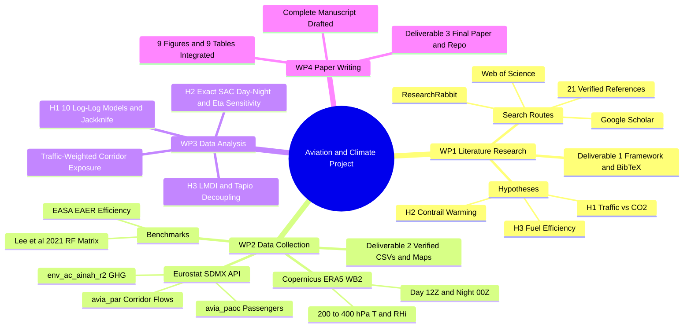
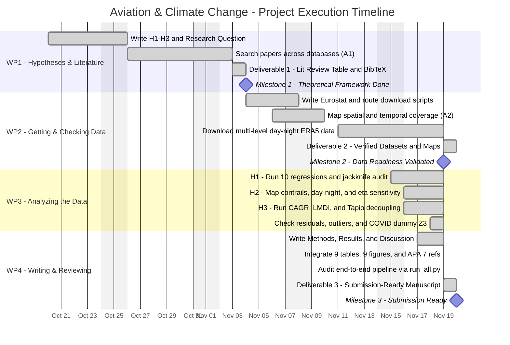
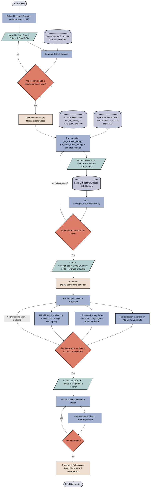

# Aviation and Climate Change: Direct CO2 Emissions, Contrail Conditions, and Fuel Efficiency in European Aviation (2008–2023)

## Table of Contents
1. [Project Overview](#1-project-overview)
2. [Research Question & Hypotheses](#2-research-question--hypotheses)
3. [Variable Operationalization](#3-variable-operationalization)
4. [Work Packages & Project Mindmap](#4-work-packages--project-mindmap)
5. [Timeline, Milestones & Kanban Board](#5-timeline-milestones--kanban-board)
6. [Research Workflow Diagram](#6-research-workflow-diagram)
7. [Risk Mitigation Table](#7-risk-mitigation-table)
8. [Repository Structure](#8-repository-structure)
9. [Data Sources, Versions, Licences & Citations](#9-data-sources-versions-licences--citations)
10. [References](#10-references)

---

## 1. Project Overview

Commercial aviation drives global mobility and trade, but it exerts complex radiative forcing pressures on the global climate system. Beyond direct carbon dioxide ($\text{CO}_2$) emitted from jet fuel combustion, aircraft operations in the cold, ice-supersaturated upper troposphere trigger persistent condensation trails (contrails) and contrail-induced cirrus clouds. These artificial clouds trap outgoing longwave infrared radiation while partially reflecting incoming solar radiation, yielding a net positive warming effect.

Although modern airframe and engine designs continuously improve fuel efficiency per passenger, rapid air traffic demand growth risks offsetting these technological gains. This repository houses the complete, reproducible data pipeline, econometric models, atmospheric reanalysis scripts, output tables, publication figures, and manuscript investigating European airspace (`34°N–70°N, 15°W–35°E`) from **2008 to 2023**.

### Summary of Empirical Findings
- **H1 (Traffic–Emissions Elasticity):** Across 10 log-log OLS, panel fixed-effects (FE), two-way FE, first-differences, and outlier-trimmed specifications (`N = 489`, 32 countries), a 1% rise in passenger volume increases aviation GHG emissions by **1.06%–1.07%** across countries in pooled models ($p < 0.0001$) and by **0.55%–0.63%** within countries in baseline fixed-effects models ($p \le 0.0004$; **0.60%** after outlier trimming with $R^2 = 0.974$, **0.81%** in annual first differences with $\text{DW} = 2.32$, and bounded between **0.55** and **0.72** in a 32-country jackknife audit).
- **H2 (Persistent Contrail Conditions & Corridor Exposure):** Across daytime (`12:00 UTC`) and nighttime (`00:00 UTC`) Copernicus ERA5 / WeatherBench2 grids (`200–400 hPa`), persistent contrail conditions ($T \le T_{\text{LM}}$, $RH_i \ge 100\%$) peak at **250 hPa** (~34,000 ft / 10.4 km) at **8.08%** of observations (occurring nearly equally at night, **8.00%** / **49.52%** of events, and day, **8.16%**), reaching **10.1%–10.8%** (up to **11.8%** at night) along dense northwest/central hubs. Weighting by 2019 Eurostat bilateral passenger-kilometres (`4,304M pax-km` across 10 core routes) shows that just three corridors—**London–Frankfurt (18.8%)**, **Paris–Madrid (14.8%)**, and **Frankfurt–Rome (13.8%)**—account for **47.4%** of total exposure. Sensitivity tests across propulsion efficiencies ($\eta = 0.25 \to 0.40$) further reveal an *engine efficiency–contrail paradox* in which higher $\eta$ raises $T_{\text{LM}}$ by $+2.34^\circ\text{C}$ and expands contrail-permissive airspace at 250 hPa from **7.88%** to **8.37%**.
- **H3 (Fuel Efficiency vs. Demand Growth):** Between 2008 and 2019, official `EU27_2020` per-passenger emissions intensity fell by **21.70%** (**-2.20%/yr**, from `175.40` to `137.34 kg CO2e/pax`), but commercial passenger demand surged by **46.66%** (**+3.54%/yr**), driving net total aviation GHG emissions up by **14.83%** (**+1.27%/yr**). Logarithmic Mean Divisia Index (LMDI) and Tapio decoupling decompositions confirm that EU27 aviation remained trapped in *weak decoupling* ($0 < e < 0.8$) across 9 of 11 pre-COVID transitions before slipping into *expansive negative decoupling* ($e = 1.31$) in 2019.

### Quickstart: Reproducing the Full Pipeline
```bash
# 1. Clone repository (with Git LFS for large Eurostat CSV archives)
git lfs install
git clone [https://github.com/SanRoy-9/Aviation_and_Climate_Change.git](https://github.com/SanRoy-9/Aviation_and_Climate_Change.git)
cd Aviation_and_Climate_Change

# 2. Install Python dependencies
pip install numpy pandas scipy statsmodels xarray netCDF4 zarr requests matplotlib cartopy

# 3. Run the complete 7-stage ingestion, modeling, and visualization pipeline
python scripts/run_all.py
```

---

## 2. Research Question & Hypotheses

### Primary Research Question
> *How does European aviation activity contribute to climate change through direct $\text{CO}_2$ emissions and persistent contrails, and to what extent can improvements in aircraft fuel efficiency reduce emissions per passenger despite increasing traffic demand?*

### Tested Hypotheses
- **H1 (Traffic–Emissions Elasticity):** Aviation-related $\text{CO}_2$ emissions increase directly with air traffic activity across and within European states.
- **H2 (Persistent Contrail Warming):** Persistent aircraft contrails form along major European flight corridors in cold, ice-supersaturated cruise air ($T \le T_{\text{LM}}$, $RH_i \ge 100\%$) and contribute to net atmospheric warming because outgoing longwave infrared heat trapping outweighs incoming shortwave solar reflection.
- **H3 (Fuel Efficiency vs. Demand Growth):** Improvements in aircraft and operational fuel efficiency reduce $\text{CO}_2$ emissions per passenger (and passenger-kilometre), but net total aviation emissions continue to rise when air traffic demand grows faster than efficiency gains.

---

## 3. Variable Operationalization

| Role | Code | Variable Name | Operational Definition | Metric / Unit | Expected Direction | Hypothesis |
| :--- | :--- | :--- | :--- | :--- | :--- | :--- |
| **Response** | **Y1** | Aviation GHG Emissions | Annual greenhouse gas emissions ($\text{CO}_2\text{e}$) from NACE Rev. 2 sector `H51` (Air transport) | Thousand tonnes $\text{CO}_2\text{e}$ (`ln_co2`) | Positive (+) | H1, H3 |
| **Predictor** | **X1** | Air Traffic Activity | Annual commercial air passengers carried (`PAS_CRD`, all schedules) | Passengers / year (`ln_pax`) | Positive (+) | H1, H3 |
| **Response** | **Y2** | Contrail Radiative Forcing | Net perturbation of Earth's radiation balance by contrail-cirrus (LW minus SW) | $\text{mW}/\text{m}^2$ (Lee et al., 2021) | Positive (+) | H2 |
| **Predictor** | **X2** | Contrail Permissibility Index | Upper-air grids meeting exact Schmidt–Appleman criterion ($T \le T_{\text{LM}}$) & ice supersaturation ($RH_i \ge 100\%$) across `200–400 hPa` (Day `12Z` & Night `00Z`) | % cruise time / grid frequency | Positive (+) | H2 |
| **Route Weight** | **W2** | Corridor Traffic Exposure | Bilateral airport-pair commercial passenger-kilometres along Europe's 10 core hub routes (`avia_par_*` $\times$ Haversine km) | Million `pax-km` / year | Positive (+) | H2 |
| **Response** | **Y3** | Specific Emission Intensity | Average greenhouse gas emissions generated per commercial passenger carried | $\text{kg}\,\text{CO}_2\text{e}/\text{pax}$ (Index `2008=100`) | Negative (–) | H3 |
| **Predictor** | **X3** | Fleet & Operational Efficiency | Combined fleet fuel efficiency, seat density, load factors, and LMDI intensity shifts | %/yr CAGR & LMDI $\Delta\text{GHG}$ | Negative (–) | H3 |
| **Control** | **Z1** | International Route Share | Share of international passengers (`INTL`) in total national commercial passengers (`TOTAL`) | % of total passengers (`share_intl_pct`) | Confounder | H1 |
| **Control** | **Z2** | Background Cloud Cover | Natural high-altitude cloud cover fraction at 250 hPa and 300 hPa | % cloud fraction (`mean_cloud_cover_Z2_pct`) | Confounder | H2 |
| **Control** | **Z3** | COVID-19 Pandemic Shock | Binary regime indicator for acute pandemic aviation restrictions (`1` = 2020–2021, `0` = other) | Binary dummy (`z3_covid`) | Confounder | H1, H3 |

---

## 4. Work Packages & Project Mindmap

### Work Packages (WPs)
This project was executed across four structured work packages:

- **WP1: Literature Research & Hypotheses (`Completed`)**
  - Formulated the research question, defined response/predictor/control variables (`Y1–Y3`, `X1–X3`, `W2`, `Z1–Z3`), and established hypotheses `H1–H3`.
  - Conducted systematic literature searches across Web of Science, Google Scholar, and ResearchRabbit, synthesizing 21 peer-reviewed references and official statistical sources.
  - Initialized the GitHub repository (`SanRoy-9/Aviation_and_Climate_Change`), configured Git LFS for large CSV archives, and documented data provenance.
- **WP2: Data Collection & Preprocessing (`Completed`)**
  - Automated Eurostat SDMX 2.1 ingestion (`get_eurostat_data.py` and `get_route_traffic_data.py`) for national GHG accounts (`env_ac_ainah_r2`), passenger traffic (`avia_paoc`), and bilateral airport-pair corridor traffic (`avia_par_*`).
  - Built a resilient, chunk-resuming HTTPS downloader (`get_era5_data.py`) for Copernicus ERA5 / WeatherBench2 pressure-level fields (`200, 250, 300, 400 hPa`) across daytime (`12:00 UTC`) and nighttime (`00:00 UTC`) timestamps (2008–2023).
  - Verified all raw files with SHA-256 checksums (`checksums.sha256`, `route_checksums.sha256`, `era5_checksums.sha256`) and generated harmonized coverage diagnostics (`coverage_and_descriptive.py`).
- **WP3: Data Analysis & Hypothesis Testing (`Completed`)**
  - **Testing H1 (`regression_analysis.py`):** Estimated 10 log-log specifications (`M1–M10`) including pooled OLS, country FE, international route-mix control (`Z1`), country-specific linear trends, two-way country/year FE, first differences, regime-slope interactions, Cook's distance outlier trimming, and a 32-country Leave-One-Country-Out jackknife.
  - **Testing H2 (`contrail_analysis.py`):** Applied the exact thermodynamic Schmidt–Appleman criterion ($T \le T_{\text{LM}}$, $RH_i \ge 100\%$) across 4 flight levels, quantified day vs. night asymmetry, tested engine propulsion efficiency sensitivity ($\eta \in \{0.25, 0.30, 0.35, 0.40\}$), ran Mann–Kendall / Sen's slope trend tests, and computed traffic-weighted corridor exposure rankings.
  - **Testing H3 (`efficiency_analysis.py`):** Performed `2008=100` index and CAGR decompositions, multi-country Logarithmic Mean Divisia Index (LMDI) decompositions, and annual Tapio decoupling elasticity classifications.
- **WP4: Paper Writing & Submission Assembly (`Completed`)**
  - Drafted and revised the complete manuscript (`Initial_Paper_Draft.md` $\to$ submission-ready paper) integrating all 9 publication figures (`fig1`–`fig5b`) and 9 summary tables (`table1`–`table4c`).
  - Audited code reproducibility via end-to-end execution of `scripts/run_all.py`.

### Project Mindmap



---

## 5. Timeline, Milestones & Kanban Board

### Gantt Chart



### Milestones & Deliverables
- **Milestone 1 (M1) [2026-11-04]:** Completed research scope, primary question, hypotheses (`H1–H3`), and literature matrix (`Deliverable 1`).
- **Milestone 2 (M2) [2026-11-19]:** Downloaded, SHA-256 verified, and harmonized all Eurostat, airport-pair route, and multi-level ERA5 datasets (`Deliverable 2`).
- **Milestone 3 (M3) [2026-11-20]:** Executed all econometric, meteorological, and LMDI/Tapio analyses and finalized the submission-ready paper and clean GitHub repository (`Deliverable 3`).

### Kanban Board

| Backlog | To Do | In Progress | In Review / Checking | Done |
| :--- | :--- | :--- | :--- | :--- |
| *None* | *None* | *None* | **[WP4]** Final submission formatting check before upload | **[WP1]** Formulate research question, hypotheses `H1–H3`, and 21-source literature synthesis |
| | | | | **[WP2]** Download & SHA-256 verify Eurostat (`env_ac_ainah_r2`, `avia_paoc`, `avia_par_*`) & ERA5 (`200–400 hPa`, Day/Night) |
| | | | | **[WP3]** Estimate `M1–M10` regressions, Cook's D outlier audit, and 32-country jackknife (`table2`–`table2c`) |
| | | | | **[WP3]** Compute exact SAC contrail maps, day/night asymmetry, $\eta$ sensitivity, ERA5 trends, & route exposure (`table3`–`table3f`) |
| | | | | **[WP3]** Compute EU27 CAGR, multi-country LMDI decomposition, & Tapio decoupling regimes (`table4`–`table4c`) |
| | | | | **[WP4]** Produce all 9 publication figures (`fig1`–`fig5b`) and write complete manuscript |

---

## 6. Research Workflow Diagram

This flowchart maps out the end-to-end research pipeline executed by `scripts/run_all.py` using standard flowchart symbols (Start/End, Process, Decision, Input/Output, Document, and Database).



---

## 7. Risk Mitigation Table

| Risk ID | Risk Event | Likelihood | Impact | Early Warning Indicator | Implemented Mitigation & Resolution |
| :---: | :--- | :---: | :---: | :--- | :--- |
| **R1** | **Copernicus ERA5 download timeouts:** Large multi-level atmospheric requests stall or drop connections. | High | High | HTTP socket read timeouts during multi-chunk downloads. | Built a resilient HTTPS Zarr chunk fetcher in `get_era5_data.py` with `urllib3` exponential backoff retries, atomic `.part` file writes, and persistent `tmp_wb2_zarr` caching across `200–400 hPa` (`34°N–70°N, 15°W–35°E`). |
| **R2** | **COVID-19 shock & outlier distortion:** The 73.3% passenger drop in 2020 or carrier bankruptcies skew regression slopes. | High | High | Non-normal residuals (`Jarque-Bera p < 0.001`) or serial correlation ($\text{DW} = 0.97$). | Added COVID dummy `Z3`, pre-COVID vs. full-sample splits (`M1–M5`), two-way FE (`M7`), annual first differences (`M8`, $\text{DW} = 2.32$), regime interactions (`M9`), Cook's distance outlier trimming (`M10`), and a 32-country jackknife. |
| **R3** | **No direct satellite contrail radiative forcing in national inventories:** Eurostat tracks fuel-burn GHG rather than contrail cirrus. | High | Medium | Territorial emissions totals cannot isolate upper-air ice-supersaturated cloud formation. | Evaluated the exact thermodynamic Schmidt–Appleman criterion ($T \le T_{\text{LM}}$, $RH_i \ge 100\%$) on ERA5 grids, weighted corridors by bilateral `pax-km`, and coupled results with Lee et al. (2021) ERF/RF benchmarks. |
| **R4** | **Eurostat API payload limits (`HTTP 413`):** Unfiltered airport-pair queries exceed server response limits. | Medium | High | `HTTP Error 413: Request Entity Too Large` on `avia_par_*` endpoints. | Implemented server-side 4D SDMX key filtering (`A.PAS_CRD.PAS.{PAIR}`) in `get_route_traffic_data.py` and archived all raw outputs with Git LFS and SHA-256 checksums (`*.sha256`). |
| **R5** | **Optional Cartopy dependency missing on headless machines:** Cartopy installation issues break map rendering. | Medium | Low | `ImportError: No module named 'cartopy'`. | Embedded built-in European coastline polygons (`EUROPE_COASTLINES`) and GeoJSON fallback routines directly inside `coverage_and_descriptive.py` and `contrail_analysis.py`. |

---

## 8. Repository Structure

```text
.
├── .gitattributes                                  # Git LFS tracking rules (*.csv)
├── data/
│   ├── raw/                                        # Read-only raw data with SHA-256 checksums
│   │   ├── era5/
│   │   │   ├── weather_europe_daynight_multilevel.nc
│   │   │   └── era5_checksums.sha256
│   │   ├── eurostat_aviation_ghg_emissions.csv
│   │   ├── eurostat_aviation_traffic_pax.csv
│   │   ├── eurostat_corridor_pax_2008_2023.csv
│   │   ├── checksums.sha256
│   │   └── route_checksums.sha256
│   └── processed/
│       └── eurostat_panel_2008_2023.csv            # Harmonized 2008–2023 country-year panel
│
├── scripts/
│   ├── get_eurostat_data.py                        # Step 01: Download Eurostat GHG & passenger tables
│   ├── get_route_traffic_data.py                   # Step 01B: Download bilateral airport-pair corridor traffic
│   ├── get_era5_data.py                            # Step 02: Download Day (12Z) & Night (00Z) ERA5 grids
│   ├── coverage_and_descriptive.py                 # Step 03: Merge panel, Table 1 & coverage map
│   ├── regression_analysis.py                      # Step 04: H1 models M1–M10, diagnostics & jackknife
│   ├── efficiency_analysis.py                      # Step 05: H3 CAGR, LMDI & Tapio decoupling
│   ├── contrail_analysis.py                        # Step 06: H2 exact SAC, day/night, eta & corridor exposure
│   └── run_all.py                                  # Master pipeline runner
│
├── reports/
│   ├── tables/                                     # All empirical output tables & full model logs
│   │   ├── table1_descriptive_stats.csv
│   │   ├── table2_h1_regression.csv
│   │   ├── table2b_h1_robustness_models.csv
│   │   ├── table2c_h1_outlier_jackknife.csv
│   │   ├── h1_full_model_summaries.txt
│   │   ├── table3_h2_contrail_stats.csv
│   │   ├── table3b_h2_corridor_frequencies.csv
│   │   ├── table3c_h2_day_night_asymmetry.csv
│   │   ├── table3d_h2_eta_cloud_sensitivity.csv
│   │   ├── table3e_h2_era5_trends.csv
│   │   ├── table3f_h2_weighted_corridor_exposure.csv
│   │   ├── table4_h3_efficiency_decomposition.csv
│   │   ├── table4b_h3_lmdi_decomposition.csv
│   │   └── table4c_h3_tapio_decoupling.csv
│   └── figures/                                    # High-resolution (300 DPI) publication figures
│       ├── coverag_map.png
│       ├── fig1_coverage_map.png
│       ├── fig3_h1_elasticity_and_residuals.png
│       ├── fig3b_h1_robustness_diagnostics.png
│       ├── fig4_h2_contrail_map.png
│       ├── fig4b_h2_daynight_eta_cloud.png
│       ├── fig4c_h2_weighted_corridors_trends.png
│       ├── fig5_h3_efficiency_vs_demand.png
│       └── fig5b_h3_lmdi_and_tapio.png
│
├── Initial_Paper_Draft.md                          # Submission-ready research manuscript
└── README.md                                       # Root repository documentation (this file)
```

---

## 9. Data Sources, Versions, Licences & Citations

1. **Eurostat (2024a) — Air Emissions Accounts (`env_ac_ainah_r2`)**
   - **Citation:** European Commission, Eurostat. (2024a). *Air emissions accounts by NACE Rev. 2 activity (Air transport: H51)* [Data set: `env_ac_ainah_r2`]. https://ec.europa.eu/eurostat/web/products-datasets/-/env_ac_ainah_r2
   - **Source / Version:** Statistical Office of the European Union (Eurostat), 2024 Production Release (`unit=THS_T`, `nace_r2=H51`, `airpol=GHG`)
   - **Licence:** Creative Commons Attribution 4.0 International (CC-BY 4.0) / EU Open Data Policy (Decision 2011/833/EU)

2. **Eurostat (2024b) — National Air Passenger Transport (`avia_paoc`)**
   - **Citation:** European Commission, Eurostat. (2024b). *Air passenger transport between reporting countries and partner entities* [Data set: `avia_paoc`]. https://ec.europa.eu/eurostat/web/products-datasets/-/avia_paoc
   - **Source / Version:** Statistical Office of the European Union (Eurostat), 2024 Production Release (`unit=PAS`, `tra_meas=PAS_CRD`, `schedule=TOTAL`)
   - **Licence:** Creative Commons Attribution 4.0 International (CC-BY 4.0) / EU Open Data Policy (Decision 2011/833/EU)

3. **Eurostat (2024c) — Bilateral Airport-Pair Passenger Transport (`avia_par_*`)**
   - **Citation:** European Commission, Eurostat. (2024c). *Air passenger transport between main airports and partner airports* [Data sets: `avia_par_de`, `avia_par_fr`, `avia_par_nl`, `avia_par_ie`, `avia_par_es`, `avia_par_it`, `avia_par_at`, `avia_par_pt`, `avia_par_pl`, `avia_par_se`]. https://ec.europa.eu/eurostat/web/products-datasets/-/avia_par_de
   - **Source / Version:** Statistical Office of the European Union (Eurostat), 2024 Production Release
   - **Licence:** Creative Commons Attribution 4.0 International (CC-BY 4.0) / EU Open Data Policy (Decision 2011/833/EU)

4. **ECMWF / Copernicus / WeatherBench2 (2020, 2023) — ERA5 Upper-Air Reanalysis**
   - **Citation:** Hersbach, H., Bell, B., Berrisford, P., et al. (2020). The ERA5 global reanalysis. *Quarterly Journal of the Royal Meteorological Society*, *146*(730), 1999–2049. https://doi.org/10.1002/qj.3803 (CDS DOI: https://doi.org/10.24381/cds.bd0915c6)
   - **Source / Version:** Copernicus Climate Change Service (C3S) / ECMWF ERA5 via WeatherBench2 6-hourly Zarr Archive (`200, 250, 300, 400 hPa`, `12:00` & `00:00 UTC`)
   - **Licence:** Copernicus Open Access Licence

5. **Lee et al. (2021) — Aviation Radiative Forcing Matrix**
   - **Citation:** Lee, D. S., Fahey, D. W., Skowron, A., et al. (2021). The contribution of global aviation to anthropogenic climate forcing for 2000 to 2018. *Atmospheric Environment*, *244*, Article 117834. https://doi.org/10.1016/j.atmosenv.2020.117834
   - **Source / Version:** Institute of Atmospheric Physics (DLR) / Manchester Metropolitan University (2000–2018 ERF/RF Assessment)
   - **Licence:** Creative Commons Attribution 4.0 International (CC-BY 4.0)

6. **Supplementary Cross-Check & Policy Benchmarks**
   - **EASA / EEA:** *European Aviation Environmental Report (EAER)* — EEA / EASA Open Access Licence
   - **European Commission JRC:** *EDGAR v8.0 Global Greenhouse Gas Emissions* — Creative Commons Attribution 4.0 International (CC-BY 4.0)
   - **EUROCONTROL & OpenSky Network:** *Aviation Intelligence Portal & Trajectory Data* — Open for Research / Academic Non-Commercial Licence

---

## 10. References

1. **Ang, B. W. (2004).** Decomposition analysis for policymaking in energy: Which is the preferred method? *Energy Policy*, *32*(9), 1131–1139. https://doi.org/10.1016/S0301-4215(03)00076-4
2. **Boulot, J.-P., Bel, G., & Joseph, R. (2023).** Looking for winning policies to address the climate issue in EU-aviation. *Journal of Air Transport Management*, *111*, Article 102434. https://doi.org/10.1016/j.jairtraman.2023.102434
3. **European Commission, Eurostat. (2024a).** *Air emissions accounts by NACE Rev. 2 activity (env_ac_ainah_r2)* [Data set]. https://ec.europa.eu/eurostat/web/products-datasets/-/env_ac_ainah_r2
4. **European Commission, Eurostat. (2024b).** *Air passenger transport between reporting countries and partner entities (avia_paoc)* [Data set]. https://ec.europa.eu/eurostat/web/products-datasets/-/avia_paoc
5. **European Commission, Eurostat. (2024c).** *Air passenger transport between main airports and partner airports (avia_par)* [Data set]. https://ec.europa.eu/eurostat/web/products-datasets/-/avia_par_de
6. **Gaillot, T., Beauchet, S., Lorne, D., & Krim, L. (2023).** The impact of fossil jet fuel emissions at altitude on climate change: A life cycle assessment study of a long-haul flight at different time horizons. *Atmospheric Environment*, *311*, Article 119983. https://doi.org/10.1016/j.atmosenv.2023.119983
7. **Gössling, S., & Lyle, C. (2021).** Climate change mitigation pathways for the aviation sector. *Sustainability*, *13*(7), Article 3656. https://doi.org/10.3390/su13073656
8. **Hersbach, H., Bell, B., Berrisford, P., et al. (2020).** The ERA5 global reanalysis. *Quarterly Journal of the Royal Meteorological Society*, *146*(730), 1999–2049. https://doi.org/10.1002/qj.3803
9. **Jungbluth, N., & Meili, C. (2019).** Recommendations for calculation of the global warming potential of aviation including the radiative forcing index. *The International Journal of Life Cycle Assessment*, *24*(3), 404–411. https://doi.org/10.1007/s11367-018-1556-3
10. **Lee, D. S., Fahey, D. W., Forster, P. M., et al. (2009).** Aviation and global climate change in the 21st century. *Atmospheric Environment*, *43*(22–23), 3520–3537. https://doi.org/10.1016/j.atmosenv.2009.04.024
11. **Lee, D. S., Fahey, D. W., Skowron, A., et al. (2021).** The contribution of global aviation to anthropogenic climate forcing for 2000 to 2018. *Atmospheric Environment*, *244*, Article 117834. https://doi.org/10.1016/j.atmosenv.2020.117834
12. **Lührs, B., Linke, F., Matthes, S., Grewe, V., & Yin, F. (2021).** Climate impact mitigation potential of European air traffic in a weather situation with strong contrail formation. *Aerospace*, *8*(2), Article 50. https://doi.org/10.3390/aerospace8020050
13. **Matthes, S., Lührs, B., Dahlmann, K., Grewe, V., Linke, F., Yin, F., Klingaman, E., & Shine, K. P. (2020).** Climate-optimized trajectories and robust mitigation potential: Flying ATM4E. *Aerospace*, *7*(11), Article 156. https://doi.org/10.3390/aerospace7110156
14. **Mayer, B., & Ding, Z. (2023).** Climate change mitigation in the aviation sector: A critical overview of national and international initiatives. *Transnational Environmental Law*, *12*(1), 14–41. https://doi.org/10.1017/S204710252200019X
15. **Miyoshi, C., & Mason, K. J. (2009).** The potential for European aviation CO2 emissions reduction through the use of larger jet aircraft. *Journal of Air Transport Management*, *15*(3), 148–151. https://doi.org/10.1016/j.jairtraman.2008.09.020
16. **Murphy, D. M., & Koop, T. (2005).** Review of the vapour pressures of ice and supercooled water for atmospheric applications. *Quarterly Journal of the Royal Meteorological Society*, *131*(608), 1539–1565. https://doi.org/10.1256/qj.04.94
17. **Prussi, M., O'Connell, A., & Lonza, L. (2021).** CORSIA: The first internationally adopted approach to calculate life-cycle GHG emissions for aviation fuels. *Renewable and Sustainable Energy Reviews*, *150*, Article 111398. https://doi.org/10.1016/j.rser.2021.111398
18. **Rädel, G., & Shine, K. P. (2008).** Radiative forcing by persistent contrails and its dependence on cruise altitudes. *Journal of Geophysical Research: Atmospheres*, *113*(D7), Article D07105. https://doi.org/10.1029/2007JD009117
19. **Schumann, U. (1996).** On conditions for contrail formation from aircraft exhausts. *Meteorologische Zeitschrift*, *5*(1), 4–23. https://doi.org/10.1127/metz/5/1996/4
20. **Sher, F., Raore, D., Klemeš, J. J., Rafi-ul-Shan, P. M., Khzouz, M., Marintseva, K., & Razmkhah, O. (2021).** Unprecedented impacts of aviation emissions on global environmental and climate change scenario. *Current Pollution Reports*, *7*(4), 549–564. https://doi.org/10.1007/s40726-021-00206-3
21. **Tapio, P. (2005).** Towards a theory of decoupling: Degrees of decoupling in the EU and the case of road traffic in Finland between 1970 and 2001. *Transport Policy*, *12*(2), 137–151. https://doi.org/10.1016/j.tranpol.2005.01.001

---

## Author

- **Name:** Sanglap Roy  
- **Repository:** [SanRoy-9/Aviation_and_Climate_Change](https://github.com/SanRoy-9/Aviation_and_Climate_Change)

### Data Sources
- Eurostat Air Transport GHG Accounts (`env_ac_ainah_r2`)
- Eurostat Commercial Air Passenger Transport (`avia_paoc`)
- Eurostat Bilateral Airport-Pair Passenger Transport (`avia_par_*`)
- ECMWF / Copernicus ERA5 Reanalysis via WeatherBench2 (`10.24381/cds.bd0915c6`)
- Lee et al. (2021) Aviation Radiative Forcing Matrix (`10.1016/j.atmosenv.2020.117834`)
- EASA / EEA European Aviation Environmental Report (EAER) & JRC EDGAR v8.0

### Licences
- Creative Commons Attribution 4.0 International (CC-BY 4.0)
- EU Open Data Policy (Decision 2011/833/EU)
- Copernicus Open Access Licence (ECMWF ERA5)
- EEA / EASA Open Access Licence

### Tags
- `research-skills`
- `aviation-climate`
- `contrails-ERA5`
- `fuel-efficiency`
- `aviation-GHG`
- `LMDI-decomposition`
